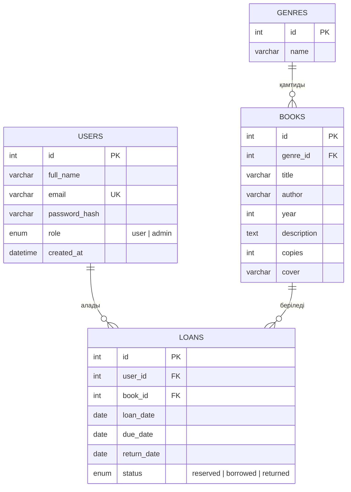

# Онлайн кітапхана жүйесі

PHP және MySQL қолданып жасалатын онлайн кітапхана веб-қосымшасы. Жеке жобалық тапсырма (8 апта).

> **Автор:** _Аты-жөніңіз, топ_
> **Күйі:** 8-апта — жоспарлау кезеңі

## Жобаның мақсаты

Оқырмандар кітаптар каталогын көріп, іздеп, қалаған кітабын брондап немесе оқуға алып, өз тарихын көре алатын онлайн кітапхана жасау. Кітапханашы (әкімші) кітаптар мен берілімдерді басқарады.

## Технологиялар

- PHP 8 (PDO)
- MySQL
- HTML, CSS, JavaScript
- Git / GitHub

## Негізгі мүмкіндіктер

- Тіркелу, кіру және шығу (`password_hash`, сессиялар)
- Кітаптар каталогы: іздеу (атауы, авторы), жанр бойынша сүзу, сұрыптау, пагинация
- Кітап беті (сипаттама, автор, жылы, қолда бар даналар саны)
- Кітапты алу / брондау және қайтару
- Оқырманның алған кітаптар тарихы
- Кітапханашы панелі: кітаптарды қосу, өзгерту, жою (CRUD), берілімдерді басқару
- Қауіпсіздік: prepared statements, `htmlspecialchars()`, валидация, рөлдер (user/admin)

## Беттер тізімі

| № | Бет | Файл | Кім үшін |
|---|-----|------|----------|
| 1 | Басты бет | `index.php` | Барлығы |
| 2 | Кітаптар каталогы (іздеу, сүзгі, пагинация) | `catalog.php` | Барлығы |
| 3 | Кітап беті | `book.php` | Барлығы |
| 4 | Тіркелу | `register.php` | Қонақ |
| 5 | Кіру | `login.php` | Қонақ |
| 6 | Шығу | `logout.php` | Оқырман |
| 7 | Менің кітаптарым (алынғандар, тарих) | `my_books.php` | Оқырман |
| 8 | Профиль | `profile.php` | Оқырман |
| 9 | Әкімші: кітаптар тізімі | `admin/books.php` | Әкімші |
| 10 | Әкімші: кітап қосу / өзгерту | `admin/book_form.php` | Әкімші |
| 11 | Әкімші: берілімдер | `admin/loans.php` | Әкімші |

## Жоспарланған қалта құрылымы

```
online-library/
├── index.php
├── catalog.php
├── book.php
├── register.php
├── login.php
├── logout.php
├── my_books.php
├── profile.php
├── admin/
├── includes/        # header.php, footer.php, db.php, functions.php
├── assets/          # css, js, images
├── uploads/
├── database.sql
└── README.md
```

## Дерекқор құрылымы (ER-диаграмма)



SQL нұсқасы: [`database.sql`](database.sql)

## Жұмыс жоспары

| Апта | Жұмыс |
|------|-------|
| 8 | Жоспарлау, README, ER-диаграмма, репозиторий |
| 9 | HTML/CSS/JS интерфейсі (кемінде 3 бет) |
| 10 | PHP-ға көшіру, include, формалар |
| 11 | MySQL, тіркелу, кіру, сессиялар |
| 12 | Кітаптар CRUD |
| 13 | Іздеу, сүзу, сұрыптау, пагинация |
| 14 | Алу/қайтару, рөлдер, қауіпсіздік |
| 15 | Тестілеу, хостинг, қорғау |
